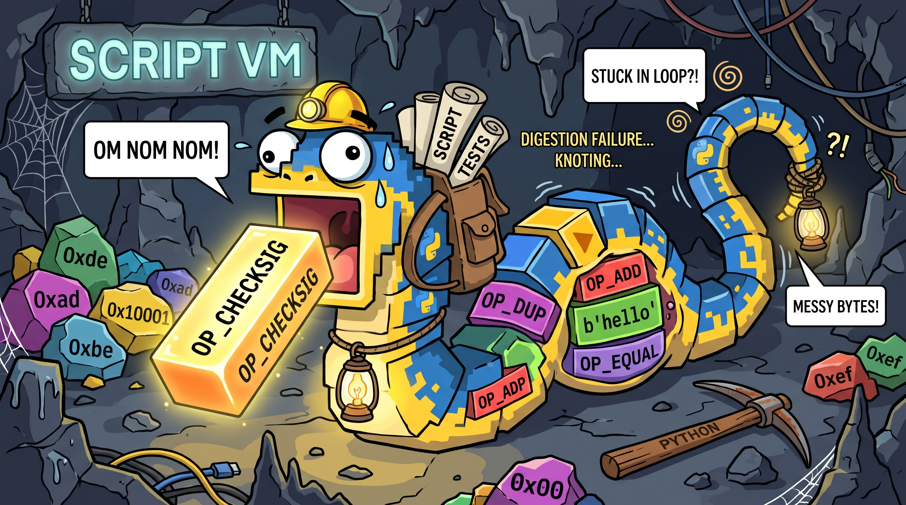
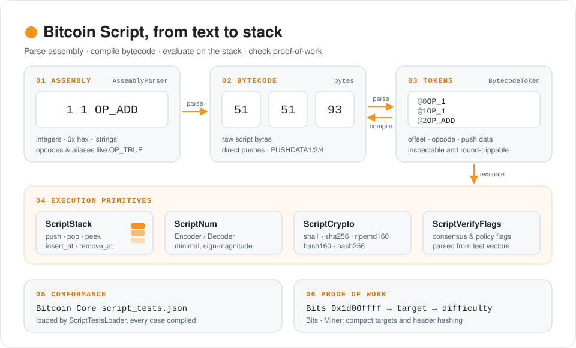

# Bitcoin Sandbox

**Bitcoin Sandbox** is a lightweight, pure-Python implementation of the Bitcoin protocol, built for education, research, and hands-on experimentation.

The project is an attempt to understand Bitcoin from the inside out by implementing its core mechanisms step by step. Rather than hiding those mechanisms behind a production node, Bitcoin Sandbox aims to provide a readable, cohesive, and hackable codebase for studying consensus rules, experimenting with custom networks, and exploring new ideas such as alternative signature schemes, VM opcodes, and AI integrations.

**Long-term goal:** build an interoperable Bitcoin node that can validate, mine, synchronize, and serve blockchain data on Mainnet, Testnet4, and isolated experimental networks, with an RPC interface and a browser-based wallet.

> **Development status:** Bitcoin Sandbox is an early-stage research project, **not yet a fully validating Bitcoin node**. It is not intended for production use or for securing real funds. Features described as goals below should not be mistaken for implemented functionality.

## Project Architecture

The roadmap is organized around five main components:

1. **Bitcoin Script VM** — script execution, transaction validation, and consensus compatibility.
2. **Miner** — proof-of-work verification and block mining.
3. **P2P** — Bitcoin protocol messages, peer connections, and blockchain synchronization.
4. **RPC & Storage** — node services, persistent blockchain data, and efficient queries.
5. **Web Wallet** — an experimental browser interface connected to the node through RPC.

## Current Development Status

The statuses below reflect the code currently implemented in this repository, not the intended final feature set.

| Component             | Status                                       | Implemented so far                                                                                                                                                                                                   | Major work remaining                                                                                                                                            |
| --------------------- | -------------------------------------------- | -------------------------------------------------------------------------------------------------------------------------------------------------------------------------------------------------------------------- | --------------------------------------------------------------------------------------------------------------------------------------------------------------- |
| **Bitcoin Script VM** | In progress                                  | Script bytecode parser/compiler, assembly parser, stack and `ScriptNum` utilities, many opcode handlers, hashing and signature-verification helpers, verification-flag definitions, and a `script_tests.json` loader | Transaction-aware signature checks, full consensus/flag enforcement, complete transaction validation, and test-suite/chain-history parity                       |
| **Miner**             | PoW prototype (sequential + multiprocessing) | Compact target (`nBits`) utilities, block-header serialization, PoW checks, sequential nonce search, working multiprocessing miner, and an experimental threading miner                                              | Verify effective parallelism with free-threaded Python, complete block construction, difficulty-rule validation, and end-to-end mining on an experimental chain |
| **P2P**               | Early foundations                            | Mainnet/Testnet4/Regtest parameters, service-flag definitions, and DNS-seed peer discovery                                                                                                                           | Network connections, protocol messages, block/transaction serialization, synchronization, relay, and encrypted transport                                        |
| **RPC & Storage**     | Planned                                      | —                                                                                                                                                                                                                    | Persistent block/chainstate storage, indexing, and RPC services                                                                                                 |
| **Web Wallet**        | Planned                                      | —                                                                                                                                                                                                                    | Browser UI, RPC integration, key management, signing, and transaction workflows                                                                                 |

## Development Roadmap

### 1. Bitcoin Script VM

**Goal:** faithfully reproduce Bitcoin's script and transaction-validation behavior, including historical consensus rules. Validation correctness takes priority over feature breadth.

**Implemented foundations:**

- [x] Parse and compile Bitcoin Script bytecode, including push-data operations.
- [x] Parse script assembly into bytecode.
- [x] Implement stack utilities, Script number encoding/decoding, and a script execution framework.
- [x] Implement handlers for many stack, control-flow, arithmetic, hash, and signature-related opcodes. These handlers are still subject to consensus testing and refinement.
- [x] Add ECDSA and Schnorr verification helpers using `btclib`.
- [x] Define script verification flags, signature-version contexts, and a loader for Bitcoin Core's `script_tests.json` cases.

**Next milestones:**

- [ ] Connect script execution to real transaction data, signature hashing, and signature verification. The current interpreter still uses a dummy signature checker.
- [ ] Enforce the applicable consensus rules and verification flags for each script context and historical activation period.
- [ ] Complete transaction validation across the original Bitcoin rules, P2SH (BIP16), SegWit (BIP141/143), and Taproot/Tapscript (BIP340/341/342).
- [ ] Pass **all** applicable Bitcoin Core `script_tests.json` cases, including expected failure behavior.
- [ ] Replay and validate transactions from Mainnet and Testnet4 block histories, comparing results against Bitcoin Core under the rules applicable at each block height.

**Acceptance criteria:** the official script test suite passes, and historical transaction-validation results agree with Bitcoin Core. Broader block- and chain-level consensus validation is also required before the node can be considered safe from consensus divergence.

### 2. Miner

**Goal:** understand and implement the full proof-of-work lifecycle, from target encoding to constructing, mining, and validating blocks.

**Implemented foundations:**

- [x] Encode/decode the compact difficulty target (`nBits`) and calculate target values.
- [x] Encode/decode Bitcoin's 80-byte block header.
- [x] Check a block-header hash against a supplied PoW target.
- [x] Search a nonce range for a header satisfying a target with the sequential `Miner`.
- [x] Implement `MultiProcessMiner`, splitting the nonce range across worker processes. **Confirmed working in local tests.**
- [x] Implement an experimental `MultiThreadMiner` with chunked nonce ranges and a shared stop event. **Not yet successfully validated in tests.**

**Next milestones:**

- [ ] Test `MultiThreadMiner` under a free-threaded (GIL-disabled) Python build and verify correctness and parallel speedup.
- [ ] Benchmark sequential, multithreaded, and multiprocessing mining implementations.
- [ ] Construct complete candidate blocks, including coinbase transactions and Merkle roots.
- [ ] Validate difficulty targets and contextual difficulty-adjustment rules.
- [ ] Implement full block validation, including transactions and consensus limits.
- [ ] Mine and validate blocks end to end on Regtest or a custom private network.

**Parallelism note:** On standard GIL-enabled CPython, threads are not expected to provide effective CPU parallelism for this small-hash mining workload. The multiprocessing implementation uses separate processes and has been tested successfully. The threading version is experimental and needs testing on free-threaded Python; it is not currently a verified speedup.

The current miner supports **PoW verification and nonce searching**, including a working multiprocessing approach, but is not yet a complete block-mining subsystem.

### 3. P2P Networking & Synchronization

**Goal:** communicate with real Bitcoin peers, exchange blocks and transactions, and independently synchronize and validate the chain. The eventual target is interoperability with Mainnet and Testnet4 nodes.

**Implemented foundations:**

- [x] Define network parameters for Mainnet, Testnet4, and Regtest.
- [x] Discover candidate peers through DNS seeds, including service-flag-prefixed queries.
- [x] Define a selection of peer service flags, including the `NODE_P2P_V2` capability bit. Defining this flag does **not** implement v2 transport.

**Next milestones:**

- [ ] Implement serialization and deserialization for full transactions, blocks, and Bitcoin P2P messages.
- [ ] Establish peer connections and implement version negotiation and handshaking.
- [ ] Implement peer management, inventory exchange, block/transaction relay, and header/block download.
- [ ] Implement initial block download, chain selection, reorganization handling, and integration with transaction/block validation.
- [ ] Support encrypted P2P transport as specified by BIP324.
- [ ] Synchronize with Mainnet and Testnet4 and operate as an interoperable validating peer.

Network discovery is available today; **peer connectivity and blockchain synchronization are not yet implemented**.

### 4. RPC Interface & Storage Engine

**Goal:** expose comprehensive Bitcoin-node functionality through a JSON-RPC interface, backed by storage designed for efficient validation, synchronization, and queries.

**Planned work:**

- [ ] Design persistent storage for raw blocks, headers, blockchain metadata, and chainstate/UTXO data.
- [ ] Build the indexes required for efficient block, transaction, and UTXO queries.
- [ ] Implement an RPC server and Bitcoin Core-compatible endpoints where practical.
- [ ] Provide APIs for node status, peer information, blockchain inspection, transaction submission, and mining controls.
- [ ] Integrate the RPC layer with synchronization, validation, mining, and the web wallet.

**Status:** not yet implemented.

### 5. Web Wallet

**Goal:** provide a browser-based wallet for learning and experimenting with Bitcoin using the sandbox node's RPC services.

**Planned work:**

- [ ] Build a simple web UI that connects to the sandbox RPC server.
- [ ] Support key generation, address management, and transaction construction and signing.
- [ ] Display balances and transaction history using node data.
- [ ] Broadcast transactions and inspect their status.
- [ ] Support safe experimentation on Regtest and other controlled networks.

**Status:** not yet implemented.

## Getting Started

Quick-start instructions and runnable examples will be added as the core modules become usable together.

For now, this repository is primarily a work-in-progress implementation and a record of the development process.

## AI Usage & Philosophy

Every line of implementation code in this repository is written by hand.

The primary motivation behind Bitcoin Sandbox is **deep, uncompromising technical comprehension**. Bitcoin does not strictly need another Python implementation; Bitcoin Core remains the gold standard. Rebuilding these mechanisms from scratch is a way to understand how they work, why they exist, and where their edge cases lie.

AI is used as a learning and writing companion, not as a substitute for implementing the protocol myself:

1. **Codebase navigation & explanation:** AI helps me read and understand complex C++ implementations and design patterns in Bitcoin Core.
2. **Design sparring & reference snippets:** AI helps explore architectural alternatives and illustrative Python examples. I study the ideas, then write the implementation myself rather than copying generated code. _(If I didn't write it myself, it's not my code.)_
3. **Documentation & writing:** Due to language barriers, AI helps draft English documentation such as this `README.md`. I review and refine the text manually. If some wording feels a little too AI-polished, I appreciate your understanding.

## References

- [Bitcoin Core — script.h](https://github.com/bitcoin/bitcoin/blob/master/src/script/script.h)
- [Bitcoin Core — script.cpp](https://github.com/bitcoin/bitcoin/blob/master/src/script/script.cpp)
- [Bitcoin Core — interpreter.h](https://github.com/bitcoin/bitcoin/blob/master/src/script/interpreter.h)
- [Bitcoin Core — interpreter.cpp](https://github.com/bitcoin/bitcoin/blob/master/src/script/interpreter.cpp)
- [Bitcoin Core — script_tests.json](https://github.com/bitcoin/bitcoin/blob/master/src/test/data/script_tests.json)
- [BIP324 — Version 2 P2P Encrypted Transport Protocol](https://github.com/bitcoin/bips/blob/master/bip-0324.mediawiki)
- [btclib](https://btclib.org/)
- [A from-scratch tour of Bitcoin in Python](https://karpathy.github.io/2021/06/21/blockchain/)
- [Programming Bitcoin](https://github.com/jimmysong/programmingbitcoin)
